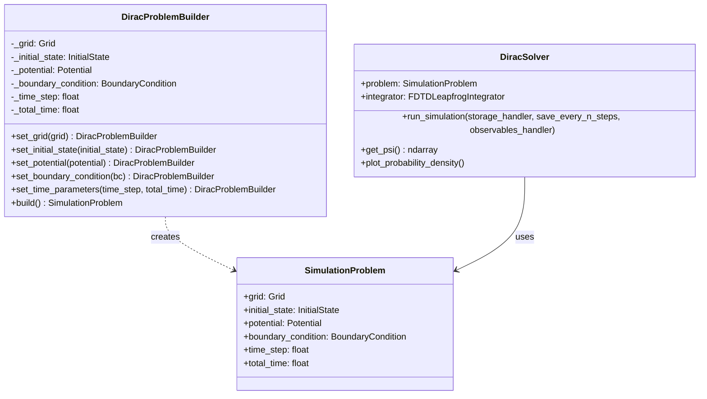
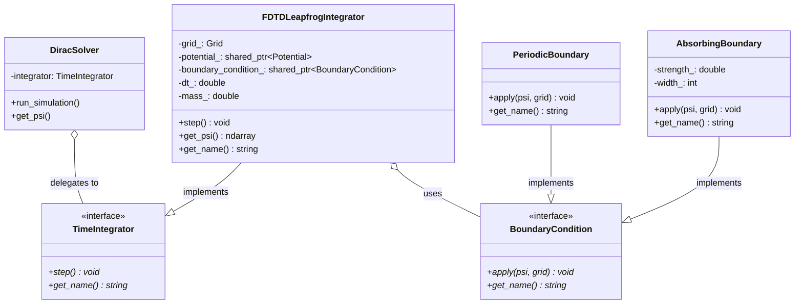
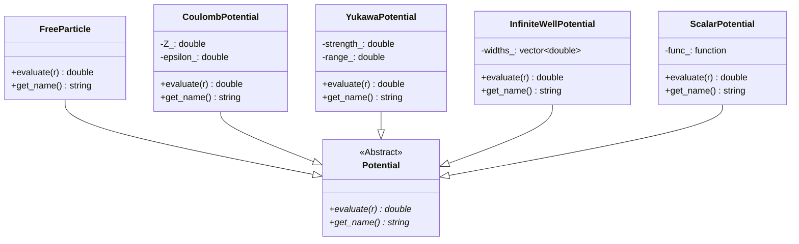
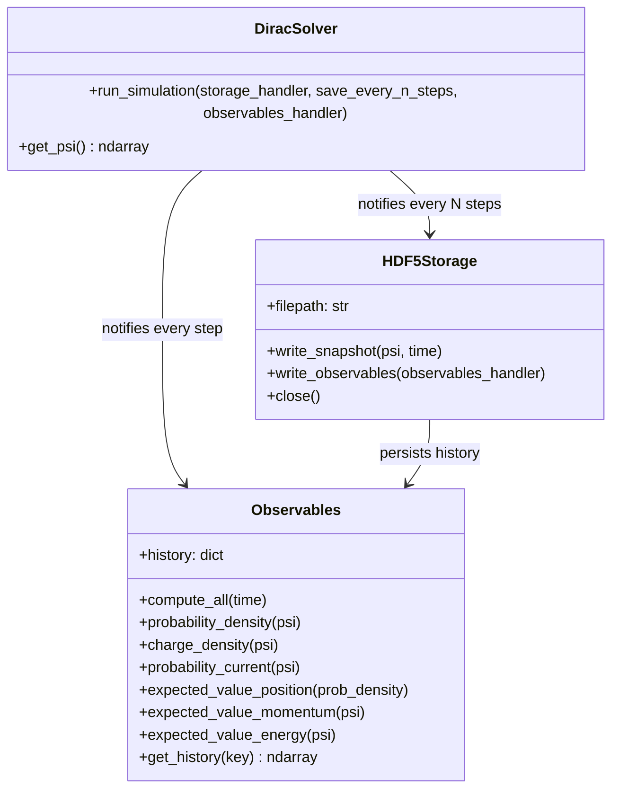
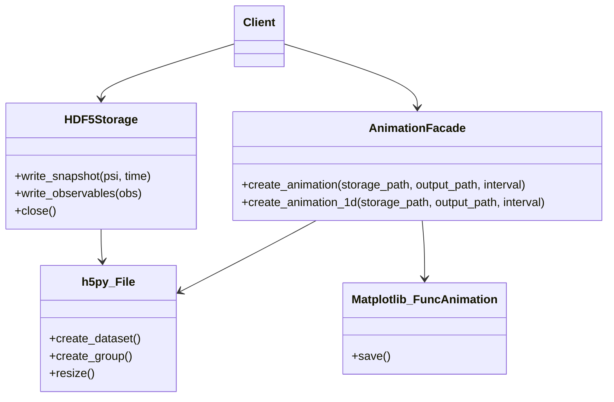
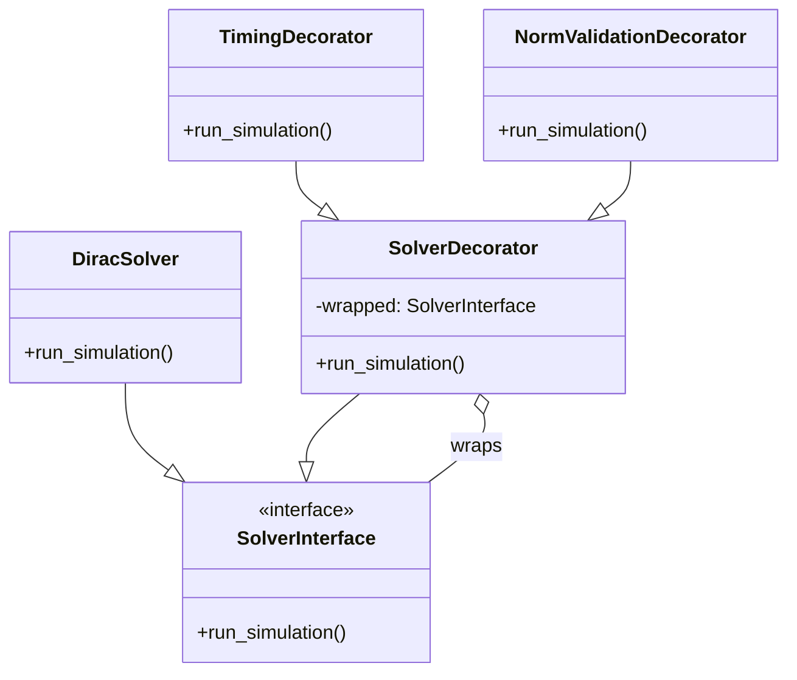
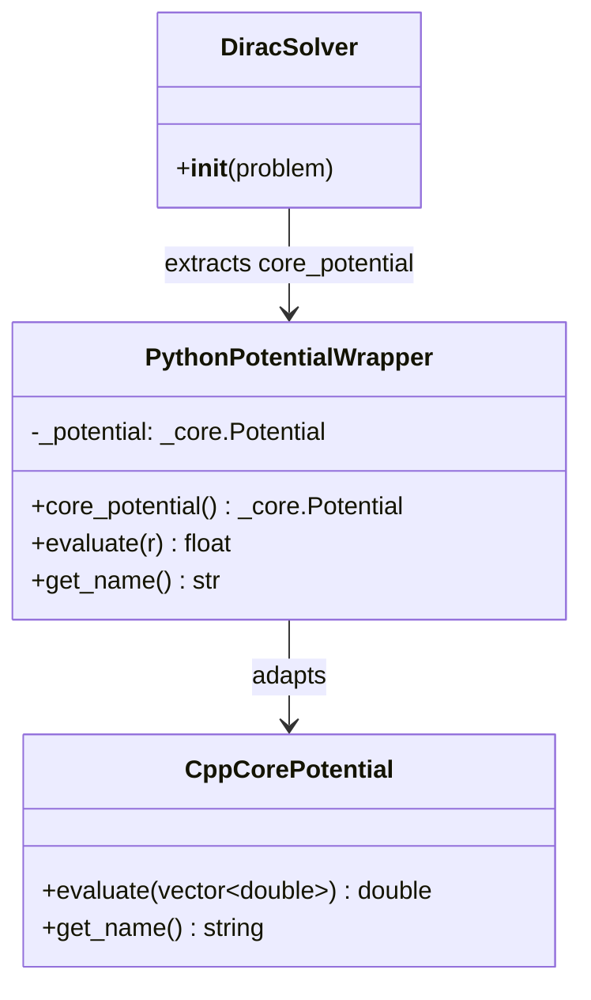

# UML Class Diagrams for the `dirac_solver` Architecture

> 🌐 **Language / Idioma:** **[Español](../es/ulm-diagrams.md)** | **English**

This document presents the UML class diagrams for the primary object-oriented design patterns implemented in the `dirac_solver` library.

---

## 1. Builder Pattern

**Application:** `DiracProblemBuilder` constructs and validates a `SimulationProblem` instance step by step, providing a fluent configuration API before initializing `DiracSolver`.

---

## 2. Strategy Pattern (Time Integrators and Boundary Conditions)

**Application:** `DiracSolver` delegates time evolution to the C++ `TimeIntegrator` interface (`FDTDLeapfrogIntegrator`) and boundary handling to `BoundaryCondition` (`PeriodicBoundary`, `AbsorbingBoundary`).

---

## 3. Template Method Pattern & Potential / Initial State Hierarchies

**Application:** The abstract base classes `Potential` (in C++) and `InitialState` (in Python) define the uniform contract implemented by all concrete scalar potentials and initial spinor distributions.

---

## 4. Observer Pattern (Observable Monitoring and Snapshot Recording)

**Application:** During `DiracSolver.run_simulation()`, the solver notifies `Observables` at every time step and `HDF5Storage` every $N$ steps without coupling the C++ integrator to analysis or disk I/O.

---

## 5. Facade Pattern (HDF5 Storage and Animation Generation)

**Application:** `HDF5Storage` and the functions `create_animation` / `create_animation_1d` provide a clean facade hiding the low-level management of extensible `h5py` datasets and `matplotlib.animation.FuncAnimation`.

---

## 6. Decorator Pattern

**Application:** Enables lightweight instrumentation (execution timing, logging, probability norm conservation checks) around solver execution without altering its core implementation.

---

## 7. Adapter Pattern

**Application:** The wrapper classes in `dirac_solver/potentials.py` adapt Python's interface to the `pybind11`-bound C++ classes (`_core`), and the architecture supports adapting external numerical backends (SciPy, CuPy, PETSc).

