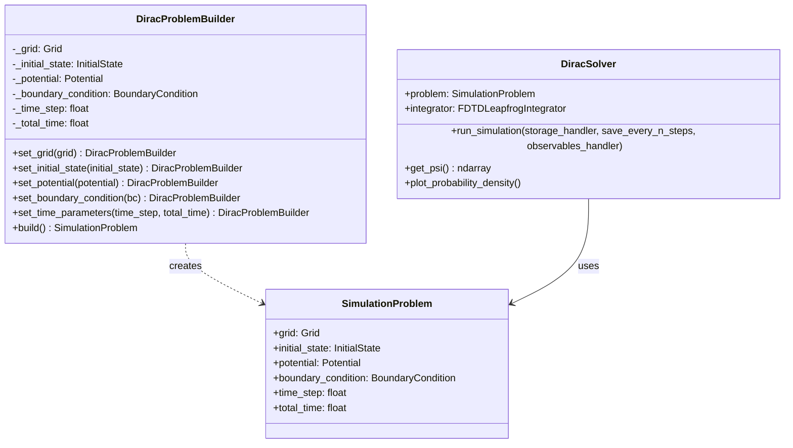
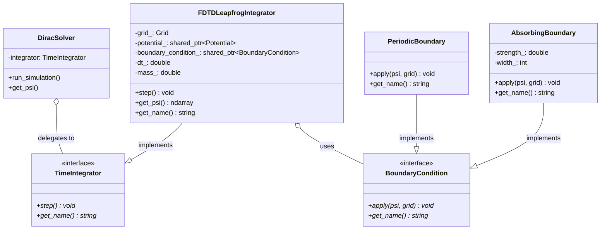
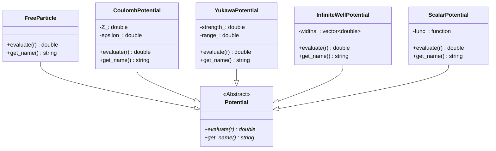
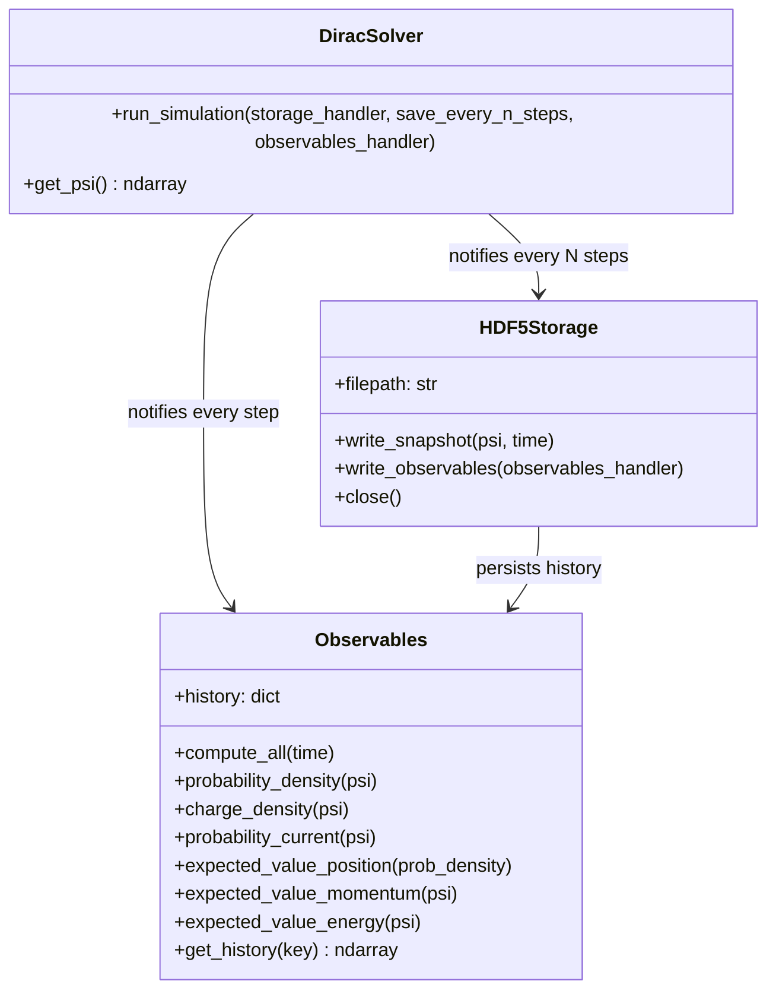
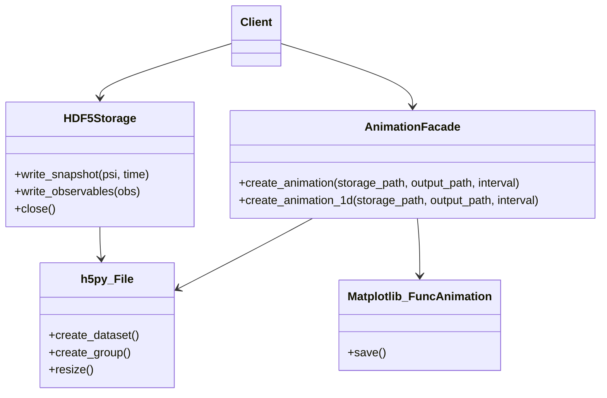
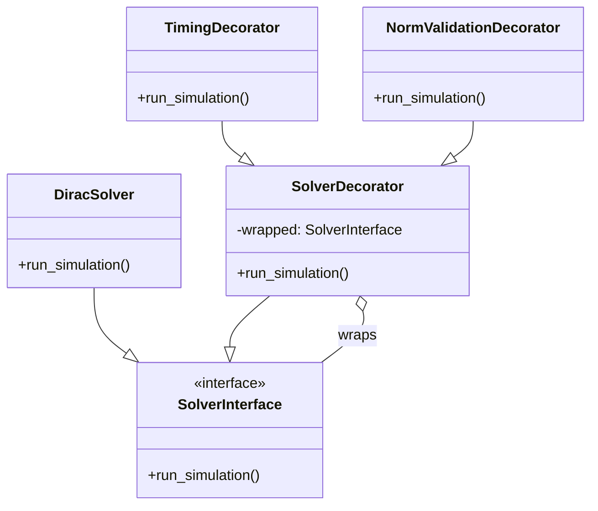
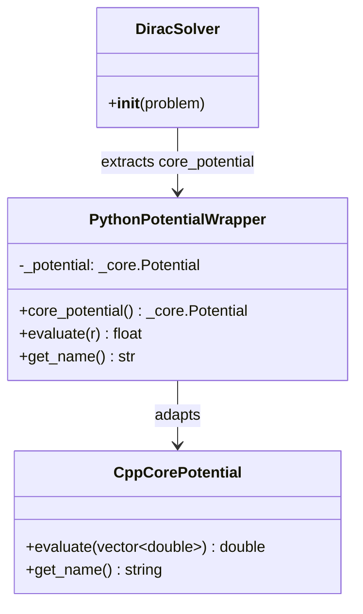

# Diagramas UML para la Arquitectura de `dirac_solver`

> 🌐 **Idioma / Language:** **Español** | **[English](../en/ulm-diagrams.md)**

Este documento contiene los diagramas de clases UML para los principales patrones de diseño utilizados en la librería `dirac_solver`.

---

## 1. Patrón Builder

**Aplicación:** `DiracProblemBuilder` construye paso a paso un objeto `SimulationProblem` validado, permitiendo una configuración fluida y legible antes de inicializar `DiracSolver`.

---

## 2. Patrón Strategy (Integradores Temporales y Condiciones de Frontera)

**Aplicación:** `DiracSolver` delega la evolución temporal a la interfaz C++ `TimeIntegrator` (`FDTDLeapfrogIntegrator`) y el tratamiento de bordes a `BoundaryCondition` (`PeriodicBoundary`, `AbsorbingBoundary`).

---

## 3. Patrones Template Method y Jerarquía de Potenciales / Estados Iniciales

**Aplicación:** Las clases base abstractas `Potential` (en C++) e `InitialState` (en Python) definen el contrato que implementan todos los potenciales escalares y configuraciones espinoriales iniciales.

---

## 4. Patrón Observer (Monitoreo de Observables y Snapshots)

**Aplicación:** Durante el bucle de `DiracSolver.run_simulation()`, el solver notifica a `Observables` y `HDF5Storage` en los pasos configurados sin acoplar el motor C++ con el análisis o la escritura en disco.

---

## 5. Patrón Facade (Almacenamiento HDF5 y Animaciones)

**Aplicación:** `HDF5Storage` y las funciones `create_animation` / `create_animation_1d` ofrecen una fachada limpia que oculta la gestión interna de datasets extensibles de `h5py` y de `matplotlib.animation.FuncAnimation`.

---

## 6. Patrón Decorator

**Aplicación:** Permite añadir instrumentación ligera (medición de tiempos, logging, validación de conservación de probabilidad) alrededor de la ejecución del solver sin alterar su implementación base.

---

## 7. Patrón Adapter

**Aplicación:** Las clases envoltorio en `dirac_solver/potentials.py` adaptan la interfaz de Python a las clases C++ enlazadas con `pybind11` (`_core`), y el diseño permite adaptar futuros backends externos (SciPy, CuPy, PETSc).

